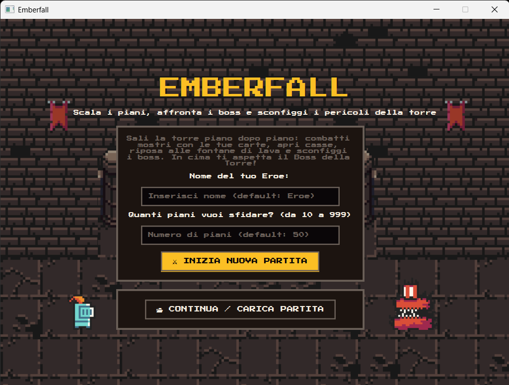

# 📌 Emberfall

Emberfall è un gioco di ruolo a turni in Java: si scala una torre piano dopo piano, si affrontano mostri e boss con un mazzo di carte, si aprono casse e ci si cura alle fontane di lava.



---
## 🚀 Come eseguire il progetto

### Prerequisiti
- JDK 25
- Gradle

### Istruzioni
```bash
git clone https://github.com/Cacciatordo/MDP_RPG_126615.git
cd MDP_RPG_126615
```

### Build del progetto
```bash
./gradlew build
```

### Esecuzione
```bash
./gradlew run
```

---

## 🤖 Uso di strumenti di AI
Ho usato un solo strumento di AI (**Claude**) per:
- definire, partendo da alcune idee che avevo buttato giù io, le varie fasi del progetto, l'ordine in cui svilupparle e la struttura, prima di passare allo sviluppo del codice;
- ricevere suggerimenti e spiegazioni su concetti e su errori di compilazione;
- bilanciare le statistiche del gioco (punti vita, attacco, armatura, esperienza) con simulazioni;
- ricevere suggerimenti su classi e costrutti della libreria standard di Java, poi adottati nel codice (per esempio Optional, Supplier);
- correggere errori di compilazione e bug che emergevano durante le prove, quando non riuscivo a risolverli rapidamente da solo.

I suggerimenti ricevuti sono stati compresi e adattati da me al progetto, poi provati e corretti durante lo sviluppo; i valori finali del bilanciamento li ho regolati io giocando.

---

## 🎮 Come si gioca
- Nel menu iniziale si sceglie il nome dell'eroe e il numero di piani della torre (da 10 a 999). Con 10 piani si incontrano tutti i tipi di piano.
- Nel corridoio ci si muove con **A / D** o con le frecce.
- Dal corridoio si può salvare e caricare la partita e tornare al menu con i pulsanti in alto.

---

## 🖼️ Crediti
Le immagini provengono da pack con licenza CC0. I crediti sono in `CREDITI_ASSET.txt`: DungeonTileset II di 0x72, DungeonTileset II Extended di Niji e 16x16 Dungeon Tileset di 0x72.

Il font è **Press Start 2P** (The Press Start 2P Project Authors), distribuito con licenza SIL Open Font License 1.1; il testo della licenza è in `src/main/resources/assets/font/OFL.txt`.